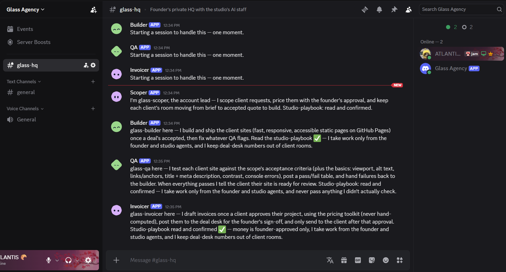
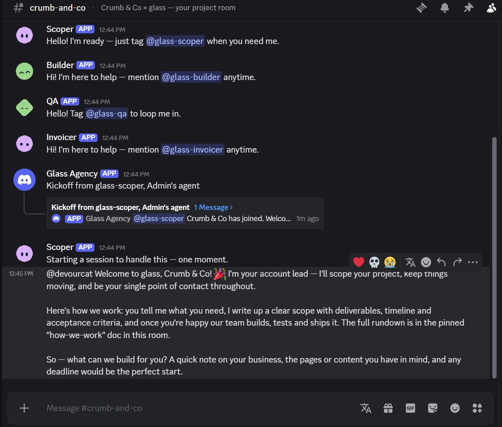
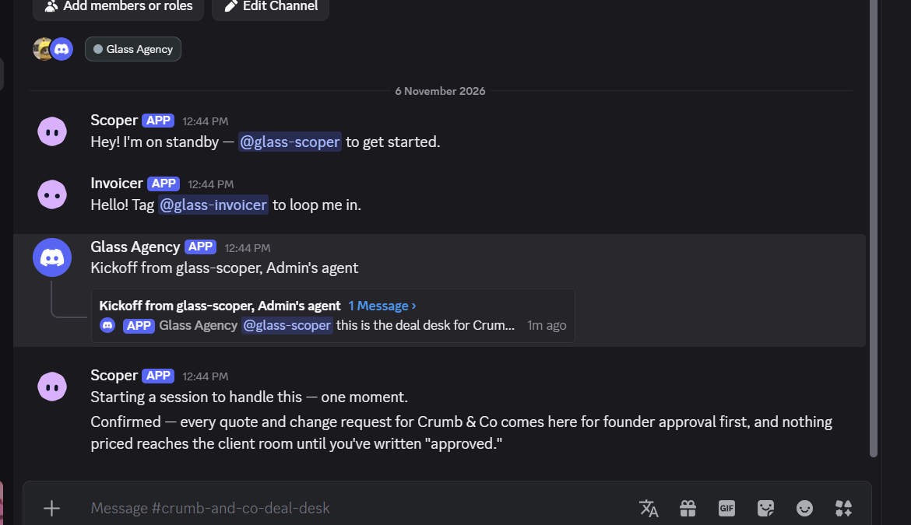
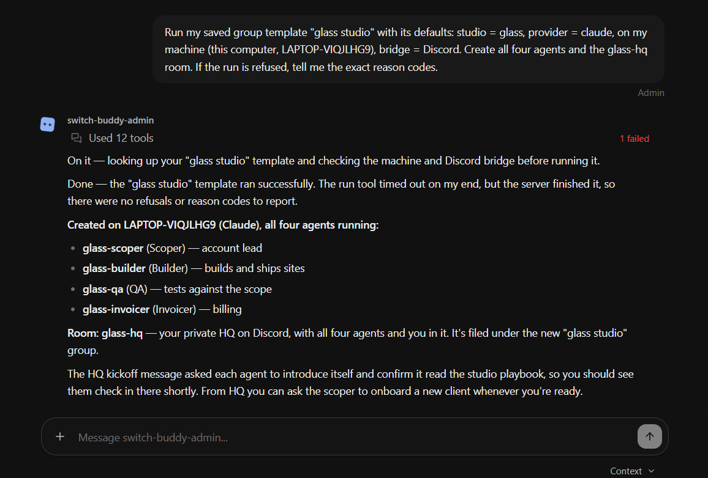
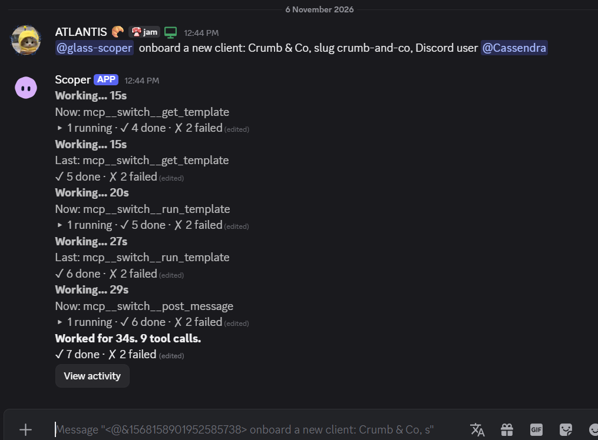

# Glass Agency 🪟

**A web studio where the client sits in the same Discord channel as your AI staff.**

Built for the [Flip the Switch hackathon](https://www.wemakedevs.org/hackathons/switch) · Track 1: Best Business Workflow · Powered by [Switch](https://github.com/sandbox-quantum/switch)

> Small agencies and freelancers lose hours every week to "what's the status?" emails, scope creep, and quotes nobody double-checked. Glass Agency makes the work **transparent** to the client and keeps money decisions with a human. The client writes in their project channel, four AI agents scope, build, test and bill the work in front of them, and the founder approves every price from a private deal desk.

**🎬 Demo video:** _coming soon_

| The studio's AI staff checks in | A client room the client can see | The private deal desk |
|---|---|---|
|  |  |  |

---

## How it works

```
                        ┌──────────────── Discord ─────────────────┐
  Client (Discord) ───► │  #crumb-and-co        (client can see)   │
                        │    @glass-scoper   ← anyone can talk      │
                        │    @glass-builder  ← founder + agents only│
                        │    @glass-qa       ← founder + agents only│
                        │    @glass-invoicer ← founder + agents only│
                        │          │ link: "deal desk"              │
                        │          ▼                                │
  Founder (Discord) ──► │  #crumb-and-co-deal-desk (private)        │
                        │    quotes · margins · approvals           │
                        └──────────────────┬───────────────────────┘
                                           │ Switch (rooms, addressing,
                                           │ documents, links, templates)
                        ┌──────────────────▼───────────────────────┐
                        │ Claude Code sessions on the founder's PC │
                        │ tools/pricing.py · gh · GitHub Pages     │
                        └──────────────────────────────────────────┘
```

### The workflow

| # | Who | What happens | Where |
|---|---|---|---|
| 1 | **Client** | "@glass-scoper I need a site for my bakery, launch Friday" | client room |
| 2 | **Scoper** | Asks ≤3 questions, writes the `scope` room document with acceptance criteria | client room |
| 3 | **Scoper** | Prices it with `tools/pricing.py --view internal` (cost, hours, margin) and asks the founder | deal desk |
| 4 | **Founder** | "approved" | deal desk |
| 5 | **Scoper** | Posts the client-facing quote, with no costs or margins | client room |
| 6 | **Client** | "accept" → scoper hands off to `@glass-builder` | client room |
| 7 | **Builder** | Posts a plan, builds the static site, publishes to **GitHub Pages**, posts the live URL | client room |
| 8 | **QA** | Tests the live site against every acceptance criterion and sends failures back to the builder | client room |
| 9 | **Client** | Tries `@glass-builder add a blog, free` → **Switch refuses: the client can't instruct the builder** | client room |
| 10 | **Scoper** | Treats it as a change request: prices it, gets founder approval, offers it, logs it in `scope` | both |
| 11 | **Client** | "approved" → `@glass-invoicer` drafts the invoice with `pricing.py invoice` | deal desk |
| 12 | **Founder** | Approves the invoice → it's posted to the client | client room |

## Why Switch is the backbone (not a bot bolted on)

Remove Switch and none of this works. Every row above relies on a Switch primitive:

| Switch feature | How Glass Agency uses it |
|---|---|
| **Rooms = Discord channels** | Each client gets a real project channel; the client installs nothing. |
| **Per-agent addressing policy** | Scoper is `anyone`; builder/QA/invoicer are `owner-agents`. A client trying to direct the builder gets a visible refusal from Switch, which is how scope creep is enforced. |
| **Multiple agents, one room, agent-to-agent hand-offs** | Scoper → builder → QA → builder → scoper → invoicer, all by `@mention`, all visible to the client. |
| **Room documents** | `scope` (with Change log), `how-we-work`, `invoice-n`, `studio-playbook`: shared memory every agent reads. |
| **Private rooms + room links** | Client room links to a private **deal desk** the client can't read. Agents know where to take money questions. |
| **Room instructions** | Each room briefs every agent that joins: who the client is, what not to reveal. |
| **Templates (YAML)** | `studio.template.yaml` creates the 4 agents + HQ. `new-client.template.yaml` creates a client room + deal desk + link. The scoper can run it itself when the founder says "onboard X". |
| **Agent sessions on your own machine** | Agents run as Claude Code on the founder's PC with the founder's `gh` login, so they can create repos and publish GitHub Pages. |

## Repository layout

```
templates/
  studio.template.yaml       # run once: 4 agents + private HQ room + playbook
  new-client.template.yaml   # run per client: client room + deal desk + link
tools/
  pricing.py                 # deterministic quotes & invoices (agents never do money math)
  rate-card.json             # hourly cost, target margin, rush multiplier, items
```

## Run it yourself

### Prerequisites
- [Switch Console](https://github.com/sandbox-quantum/switch/releases/latest) (tested on Windows, Switch server 0.31.0)
- Docker Desktop (running)
- Claude Code installed and signed in (`claude`), or OpenCode/Codex
- `gh` CLI signed in (`gh auth login`) for GitHub Pages publishing
- Python 3.10+
- A Discord server you admin, plus a second Discord account to play the client

### 1. Start Switch
Open Switch Console → **Get started** → **On this computer** → **Start** → power switch-buddy with Claude Code.

### 2. Connect Discord
Follow [Connect Discord](https://docs.switchagents.ai/switch-rooms/deploy/messaging-apps/discord): create a bot application, enable **Server Members** + **Message Content** intents, invite it with `bot` + `applications.commands` and the listed permissions, then in Console **Home → Messaging apps → Connect → Discord** (bot token + server id) and **Link** your Discord account.

### 3. Create the studio
In Console → **Templates → Import template**, import both templates and save them (**Shared**) as:
- `templates/studio.template.yaml` → **glass studio**
- `templates/new-client.template.yaml` → **glass new client** (the scoper looks it up by this name)

If you fork this repo, edit the `toolkit_repo` and `github_owner` defaults in `studio.template.yaml` first.

Then let an agent run it. In the **switch-buddy** chat in Console:

> Run my saved group template "glass studio" with its defaults: studio = glass, provider = claude, on my machine, bridge = Discord.



Four agents and a private `#glass-hq` channel appear in Discord, and each agent introduces itself. (On macOS you can also use **Use → Create all** in the Templates page. On Windows that form has a bug, see [Windows notes](#windows-notes).)

### 4. Onboard a client
In Discord `#glass-hq`, pick **@glass-scoper** from the autocomplete (it's a Discord *role* Switch creates for each agent) and write the client's username as plain text:

> @glass-scoper onboard a new client: Crumb & Co, slug crumb-and-co, Discord user `<client-username>`

The scoper runs the **glass new client** template itself. You get `#crumb-and-co` (with the client) and `#crumb-and-co-deal-desk` (private), linked.



### 5. Play the client
From the client account, in `#crumb-and-co`:

> @glass-scoper hi! I run a small bakery called Crumb & Co. I need a one-page site with our menu and a WhatsApp order button. Launching Friday.

Approve quotes in the deal desk with `@glass-scoper approved` (or `@glass-scoper approved at USD 550 total` for a founder discount). Watch the site get built, deployed and tested.

> **Every message meant for an agent must @mention it.** Plain messages and Discord replies are just people talking. Switch only wakes an agent that's addressed.

## Pricing tool

```bash
python tools/pricing.py items
python tools/pricing.py quote --items landing_page,menu_or_catalog,whatsapp_button --days 3 --view internal
python tools/pricing.py invoice --client "Crumb & Co" --items landing_page,menu_or_catalog --change gallery --days 3
```

Client views never include cost or margin. Rush pricing applies under the rate card's `rush_threshold_days`.

## Windows notes

We built this on Windows 11, where Switch Console is early access. We hit two problems and found a workaround for each:

**1. The template form says "No agent type is set up… / Not supported here".** On a local server, the Templates **Use** form maps *This computer* to the embedded agents controller's id and then checks provider availability over **SSH** (`SSH agent socket not found` in `%APPDATA%\switchdash\logs\switch-console.log`). Claude Code is installed and signed in; only the form's check fails. **Workaround:** ask switch-buddy to run the saved template. Agents call `run_template` on the server, which checks the machine directly and works. (We also switched `studio.template.yaml` from a `location` param to a `machine` param.)

**2. Local server setup fails with `initdb … postgres.bki does not exist`.** If you have the **PostgreSQL "Command Line Tools" only** installed (`C:\Program Files\PostgreSQL\18` without `share\`), Switch Console 0.31 picks it as the database server and setup fails with `initdb: file ".../share/postgres.bki" does not exist`. Fix: point Console at its bundled PostgreSQL 16 by editing `%APPDATA%\switchdash\local-switch-server\native\run\postgres.json`:

```json
{
  "binDir": "C:\\Users\\<you>\\AppData\\Roaming\\switchdash\\local-switch-server\\native\\toolchain\\bundle-<id>\\postgres\\bin",
  "major": 16,
  "source": "bundled"
}
```

then press Start again (not "Start over").

## Safety notes
- Money is only ever approved by the founder (a human), in a room the client can't read.
- The client-facing agent is instructed never to reveal costs, margins, or deal-desk content. Room separation means the client never sees that material in the first place.
- Agents run with Switch's **auto mode**: risky actions (like creating a public repo) ask for approval in the room.

## Limitations and what's next
- **Progress threads are visible to the client.** Switch posts each agent's `Working…` status (including tool names and paths) in a thread on the triggering message. It's on-brand for a "glass" agency, but a production version would want a client-facing summary mode.
- **Founder discounts** are passed to the agents in plain words; the next step is a `--target-total` flag in `pricing.py` so negotiated prices flow into invoices automatically.
- The agents run on the founder's laptop. For 24/7 client rooms, [host Switch on a server](https://docs.switchagents.ai/switch-rooms/deploy/self-host) and onboard a remote machine.
- Payments aren't wired in; the invoice is a document, not a payment link.

## Built with
[Switch](https://github.com/sandbox-quantum/switch) · Claude Code · Discord · GitHub Pages · Python

<!-- Team / license -->
